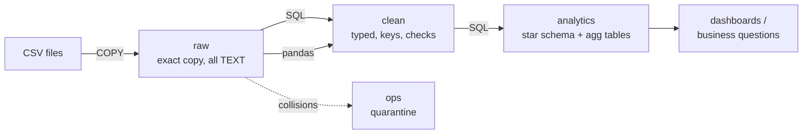
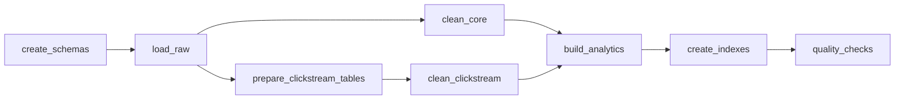

# QuickCart Data Platform

A small, complete data platform for **QuickCart**, a fast-growing e-commerce and logistics company.
It loads four raw CSV files into PostgreSQL, cleans them, models them into a star schema with
pre-aggregated dashboard tables, checks its own numbers, and runs every day with Apache Airflow.

**Stack:** Python 3.12 · pandas 3 · SQL (PostgreSQL 16) · Apache Airflow 3.3.2 · Docker Compose

Author: Alfred Esan · Ironhack Data Engineering bootcamp, Mini Project 2

---

## The business problems, and what this project does about them

| QuickCart problem | What the platform does | Where |
|---|---|---|
| Slow dashboard performance | Pre-aggregated `agg_*` tables, so dashboards read a few hundred ready rows. Measured: **331 ms → 0.46 ms** | `sql/05`, `sql/07` |
| Duplicate customer records | PRIMARY KEY + UNIQUE email + `DISTINCT ON` make duplicates impossible in the clean layer | `sql/03` |
| Delayed reporting | One Airflow DAG rebuilds everything automatically every day at 06:00 | `dags/` |
| Pipeline failures | Transactions (all-or-nothing), 2 automatic retries per task, and a quality gate | `sql/*`, `pipeline/quality_checks.py` |
| High storage costs | Real data types instead of text: the same 2M rows take **12% less space** | `sql/03`, `sql/07` |
| Difficulty processing clickstream logs | pandas job fixes 25 spellings, 3 timestamp formats and ID collisions, and quarantines what it can't trust | `pipeline/clean_clickstream.py` |
| Poor query performance on large datasets | Indexes on foreign keys, dates and a partial index. Measured: **145 ms → 0.56 ms** | `sql/06`, `sql/07` |

---

## Architecture




| Layer (schema) | What it holds | Rule |
|---|---|---|
| `raw` | The four files exactly as received, plus `_row_num` and `_loaded_at` | Never edited. Everything can be rebuilt from here. |
| `clean` | `customers`, `products`, `orders`, `clickstream` with real types | The database refuses bad data: PRIMARY/FOREIGN KEY, UNIQUE, CHECK |
| `ops` | `clickstream_rejected`: rows we couldn't trust, with the reason | Nothing is deleted silently |
| `analytics` | `dim_customer`, `dim_product`, `fct_orders` + four `agg_*` summary tables | One definition of revenue for every dashboard |

More detail: [docs/architecture.md](docs/architecture.md)

---

## The pipeline (Airflow DAG `quickcart_pipeline`)



| Task | Runs | What it does |
|---|---|---|
| `create_schemas` | `sql/01_create_schemas.sql` | Creates the `raw`, `clean`, `analytics`, `ops` schemas |
| `load_raw` | `sql/02_load_raw.sql` | Bulk-loads the CSV files with `COPY` |
| `clean_core` | `sql/03_clean_core.sql` | Typed customers, products, orders with keys and checks |
| `prepare_clickstream_tables` | `sql/04_create_clickstream_tables.sql` | Creates the clean and quarantine tables for the clickstream |
| `clean_clickstream` | `pipeline/clean_clickstream.py` | pandas cleaning: 2000 raw rows → 1963 clean + 37 quarantined |
| `build_analytics` | `sql/05_build_analytics.sql` | Star schema and pre-aggregated dashboard tables |
| `create_indexes` | `sql/06_indexes.sql` | Indexes for the most common filters and joins |
| `quality_checks` | `pipeline/quality_checks.py` | 7 checks. The run fails if any number doesn't add up. |

Schedule: daily at 06:00 (Europe/Amsterdam), `catchup=False`, `max_active_runs=1`, 2 retries per task.
Every step is **idempotent**: running it twice gives the same result as running it once.

---

## Data quality and decisions

Profiling (`pipeline/profile_data.py`) found these issues. Every rule is written down in
[docs/decisions.md](docs/decisions.md) before it was coded.

| Issue found | How it's handled |
|---|---|
| 25 spellings of 6 event types (`Click`, `CLICK `, `clik`…) | Standardised to `page_view, click, search, add_to_cart, purchase, log_out` |
| 3 timestamp formats; slash dates could be day/month or month/day | Each format parsed explicitly. Proven day/month: only 303 of 691 slash dates can be read as month/day |
| 37 rows reuse an `event_id` but are different events | First row (file order) kept; the rest quarantined in `ops.clickstream_rejected` |
| 424 missing device types, 60 anonymous visitors | Device becomes `unknown`; anonymous visitors are kept (`is_anonymous`) |
| 181 of 500 orders dated after today | Kept and flagged `is_future_dated`; left out of the "actuals" dashboard tables |
| Revenue definition | Paid orders only. Refunds, pending and failed amounts are reported separately |

**Quality gate**, run at the end of every pipeline run:

1. Every raw clickstream row is either clean or quarantined
2. No orders lost between raw and clean
3. No clickstream events for unknown customers
4. One fact row per clean order
5. Daily revenue adds up to clean paid orders
6. Dashboard tables are not empty
7. Quarantined share of the clickstream is at most 5%

---

## Results

**Performance**, measured on a 2-million-row copy of the orders table ([full output](docs/performance_results.txt)):

| Test | Before | After | Fix |
|---|---|---|---|
| One customer's orders | 145 ms | 0.56 ms | Index on `customer_id` |
| One week of sales | 101 ms | 7 ms | Index on `order_date` |
| Dashboard: revenue for every day | 331 ms | 0.46 ms | Pre-aggregated summary table |
| Storage of 2M rows | 131 MB | 115 MB | Real data types instead of text |

**Business findings**: [docs/business_insights.md](docs/business_insights.md) (all 10 queries in `sql/08_business_questions.sql`).
Headlines: Electronics and Furniture make 90.8% of revenue; 25 loyal customers bring 52.8% of it;
109,595 sits in pending payments; the top-earning product (4K Monitor) has a 13% refund rate.

---

## How to run it

**You need:** Docker with Docker Compose, and Python 3.12 for the optional laptop scripts.

```bash
# 1. Get the code and create your private settings file
git clone git@github.com:AlfredEsan-ironhack/quickcart.git && cd quickcart
printf 'POSTGRES_USER=quickcart\nPOSTGRES_PASSWORD=%s\nPOSTGRES_DB=quickcart\n' "$(openssl rand -hex 12)" > .env
chmod 644 data/raw/*.csv          # Postgres runs as another user inside its container

# 2. Start the warehouse, Airflow's database and Airflow (first build takes a few minutes)
docker compose up -d --build

# 3. Airflow login: user "admin", password from this file
docker compose exec airflow cat /opt/airflow/simple_auth_manager_passwords.json.generated
```

Open **http://localhost:8081**, switch on `quickcart_pipeline` and press ▶ to run it.

**Without Airflow**, from the laptop (same steps, same order):

```bash
python3 -m venv .venv && source .venv/bin/activate && pip install -r requirements.txt
scripts/run_pipeline.sh
```

**Explore the data:**

```bash
scripts/run_sql.sh sql/08_business_questions.sql      # the business questions
scripts/run_sql.sh sql/07_performance_demo.sql        # the 2M-row speed test (~20 s)
scripts/run_sql.sh <<'SQL'
SELECT * FROM analytics.agg_product_performance ORDER BY revenue DESC;
SQL
```

| Service | Address |
|---|---|
| Warehouse (Postgres) | `localhost:5433`, user and password from `.env` |
| Airflow UI | http://localhost:8081 |

---

## Project structure

```
quickcart/
├── airflow/Dockerfile          Airflow 3.3.2 + a separate Python environment for the pipeline
├── dags/quickcart_pipeline.py  The daily DAG (order, schedule, retries; no business logic)
├── data/raw/                   The four source CSV files
├── docs/
│   ├── architecture.md/.png    Architecture diagram and explanation
│   ├── business_insights.md    Findings for the business
│   ├── business_answers.txt    Full output of the business queries
│   ├── decisions.md            Every data rule and why (D1–D13)
│   ├── design_faq.md           Design questions and answers
│   └── performance_results.txt Before/after measurements
├── pipeline/
│   ├── profile_data.py         Stage 2 profiling: looks at the raw data before any design
│   ├── transforms.py           Clickstream cleaning rules
│   ├── clean_clickstream.py    The pandas cleaning job
│   ├── quality_checks.py       The quality gate
│   ├── run_sql_file.py         Runs a .sql file (used by Airflow)
│   └── db.py                   One place that knows how to connect
├── scripts/
│   ├── run_pipeline.sh         Whole pipeline from the laptop
│   └── run_sql.sh              Run a .sql file or typed SQL inside the Postgres container
├── sql/01 … 08                 Numbered in run order
├── docker-compose.yml          Warehouse, Airflow database, Airflow
├── .env.example                Which settings are needed (real values live in .env, never in git)
└── requirements.txt            Exact Python package versions
```

## Deliverables

| Required | Delivered |
|---|---|
| SQL scripts (.sql) | `sql/01` to `sql/08` |
| Python scripts / notebooks | `pipeline/*.py` |
| Airflow DAG | `dags/quickcart_pipeline.py` (+ `airflow/Dockerfile`, `docker-compose.yml`) |
| Architecture diagram | `docs/architecture.png` (source: `docs/architecture.mmd`) |

## Limitations and next steps

- **Full reload every run.** Fine for this data size. For big tables: incremental loads (only new rows) and partitioning by date.
- **Alerting:** failures are visible in Airflow but not yet emailed or sent to Slack.
- **Analytics engine:** a columnar warehouse (BigQuery, Snowflake, Databricks) or Parquet files would compress far better than row-based Postgres.
- **Transformations as code:** dbt would add tests, documentation and lineage for the SQL models.
- **Tests and CI:** unit tests for `transforms.py` and a GitHub Actions check on every push.
- **The data is synthetic.** Numbers are as of 2026-10-28; the future-dated orders rule (D7/D13) is awaiting confirmation.
