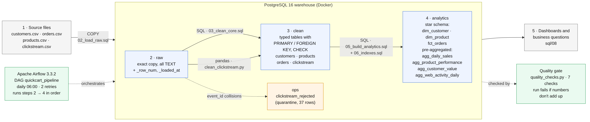
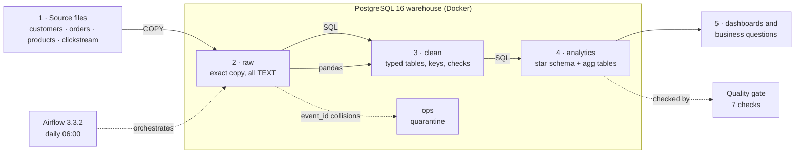

# QuickCart: architecture

The picture is generated from [architecture.mmd](architecture.mmd) (Mermaid). GitHub also renders the
version below directly.

## How data flows

| Step | From → To | Tool | Key idea |
|---|---|---|---|
| 1 → 2 | CSV → `raw` | `COPY` (`sql/02`) | Store exactly what arrived, all TEXT, with the file's row order (`_row_num`) |
| 2 → 3 | `raw` → `clean` (customers, products, orders) | SQL (`sql/03`) | Real types; PRIMARY KEY, FOREIGN KEY, UNIQUE and CHECK refuse bad data |
| 2 → 3 | `raw` → `clean.clickstream` | pandas (`pipeline/clean_clickstream.py`) | 25 spellings → 6 events, 3 timestamp formats parsed explicitly |
| 2 → ops | `raw` → `ops.clickstream_rejected` | pandas | Rows that reuse an `event_id` are kept aside with a reason, not deleted |
| 3 → 4 | `clean` → `analytics` | SQL (`sql/05`, `sql/06`) | Star schema + pre-aggregated tables + indexes |
| 4 → 5 | `analytics` → dashboards | SQL (`sql/08`) | Queries read ready-made tables and run in milliseconds |

## Containers (docker-compose.yml)

| Container | Image | Purpose | Port on the laptop |
|---|---|---|---|
| `quickcart-postgres` | `postgres:16` | The warehouse | `127.0.0.1:5433` |
| `quickcart-airflow-db` | `postgres:16` | Airflow's own bookkeeping (runs, task states). Kept apart from business data. | not published |
| `quickcart-airflow` | built from `airflow/Dockerfile` | Scheduler, web UI and task runner (`airflow standalone`) | `127.0.0.1:8081` |

All ports are bound to `127.0.0.1`, so only the laptop itself can reach them.

## Design principles

- **Layered:** raw is never edited, so every later layer can be rebuilt from it in seconds.
- **Idempotent:** every script can run again and again with the same result (full rebuilds, `IF NOT EXISTS`, `TRUNCATE` + reload in one transaction).
- **All-or-nothing:** each step runs in a transaction, so a failure never leaves half-written tables.
- **Nothing disappears silently:** row counts are reconciled, and rejected rows are kept with a reason.
- **Rules live in the database:** constraints protect the data no matter which tool writes it.
- **Measured, not assumed:** performance claims come from before/after tests (`docs/performance_results.txt`).
